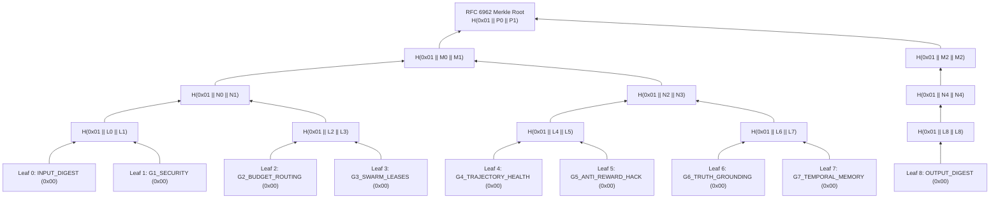

# 🛡️ NexusAegis (`nexus-aegis`)

[](https://github.com/codesphere-u/nexus-aegis/actions/workflows/ci.yml)
[](https://www.python.org/downloads/)
[](LICENSE)
[](pyproject.toml)
[](nexus_aegis/mcp_server.py)

**Proof-Carrying Autonomous Agent Kernel & Cryptographic Pull Request Attestation Engine (`v1.0.0`, with MCP Server)**

---

## 1. Why NexusAegis Exists: Proof-Carrying Agent Execution (PCAE)

In 1997, George Necula introduced **Proof-Carrying Code (PCC)**: a foundational systems security paradigm in which an untrusted binary must carry a formal, machine-checkable proof that it obeys safety invariants before a host kernel executes it.

In 2026, engineering teams face the exact same crisis with **autonomous AI coding and operations agents**. When an autonomous agent opens a pull request, executes shell or MCP tools, modifies unit tests, or synthesizes an incident postmortem, human reviewers have **zero mathematical proof** that the agent:

1. **Was not hijacked** by direct or indirect prompt injection, zero-width steganography, Base64 smuggling, or SSRF/credential exfiltration tool calls (`G1_SECURITY`).
2. **Did not breach its USD/token budget** or over-provision an expensive frontier model (`claude-opus-4`, `o1-pro`) on a trivial typo fix (`G2_BUDGET_ROUTING`).
3. **Did not race or clobber files** locked under `exclusive_write` or `shared_read` glob leases by concurrent peer subagents (`G3_SWARM_LEASES`).
4. **Did not enter an infinite `A <-> B` tool oscillation loop**, repeat failing tool calls, or emit malformed MCP schemas (`G4_TRAJECTORY_HEALTH`).
5. **Did not reward-hack the test suite**—deleting `test_*` functions, weakening assertion counts, inserting `assert True` tautologies, injecting `@pytest.mark.skip`, snooping `PYTEST_CURRENT_TEST`, or swallowing exceptions with `except: pass`—to fake a green CI build (`G5_ANTI_REWARD_HACK`).
6. **Did not hallucinate phantom citations (`[doc_99]`)**, invert negation/antonym polarity (`enabled` $\leftrightarrow$ `disabled`), drift numeric SLA metrics, or reference non-existent workspace AST symbols (`G6_TRUTH_GROUNDING`).
7. **Did not contaminate its output with stale memory** by relying on expired (`valid_until != None`) or superseded (`superseded_by != None`) architectural facts (`G7_TEMPORAL_MEMORY`).

**`nexus-aegis`** introduces **Proof-Carrying Agent Execution (PCAE)**:
- It executes a **7-Gate Deterministic Verification Pipeline** in **`0.27 ms` (P50)** with **zero external runtime dependencies** and **zero probabilistic LLM-as-a-Judge calls**.
- It hashes the canonical task input digest, all 7 deterministic gate verdicts, and the output digest into an **RFC 6962 domain-separated binary SHA-256 Merkle tree** (`0x00` leaf prefix, `0x01` internal node prefix), producing a signed **`AegisAttestationBundle`**.
- It generates **`O(log N)` Selective-Disclosure Merkle Inclusion Proofs** so an external auditor or CI pipeline can cryptographically verify that any single gate (e.g., `G5_ANTI_REWARD_HACK: PASSED`) belongs to the signed Merkle root **without exposing proprietary prompts, internal RAG context, or private source code diffs**.
- It renders a drop-in **GitHub Pull Request Cryptographic Attestation Markdown Card** (`render_pr_attestation_markdown`) ready for automated CI comments.

---

## 2. Unifying the 8-Repository Codesphere Agentic Stack

`nexus-aegis` is the cryptographic capstone kernel that unifies the core verification algorithms of the entire **Codesphere Agentic Stack**:

```mermaid
flowchart LR
    subgraph Stack["Codesphere Agentic Stack (7 Specialized Engines)"]
        G1["1. agentshield<br/>(G1_SECURITY)"]
        G2["2. synapse-router<br/>(G2_BUDGET_ROUTING)"]
        G3["3. swarmweaver<br/>(G3_SWARM_LEASES)"]
        G4["4. agentflight<br/>(G4_TRAJECTORY_HEALTH)"]
        G5["5. patchpilot<br/>(G5_ANTI_REWARD_HACK)"]
        G6["6. truthgate<br/>(G6_TRUTH_GROUNDING)"]
        G7["7. cortex-mcp<br/>(G7_TEMPORAL_MEMORY)"]
    end

    Run["AgentRunBundle<br/>(Execution Under Audit)"] --> Stack
    Stack --> Merkle["8. nexus-aegis<br/>RFC 6962 SHA-256 Merkle Kernel"]
    Merkle --> Cert["AegisAttestationBundle<br/>+ O(log N) Inclusion Proofs"]
    Merkle --> PR["GitHub PR Attestation Card"]
```



| Gate ID | Codesphere Engine | Core Deterministic Verification Mechanism |
| :--- | :--- | :--- |
| **`G1_SECURITY`** | [`codesphere-u/agentshield`](https://github.com/codesphere-u/agentshield) | Regex + Base64/Unicode steganography scanner blocking prompt overrides, cloud metadata SSRF (`169.254.169.254`), and `.env`/`.ssh` exfiltration. |
| **`G2_BUDGET_ROUTING`** | [`codesphere-u/synapse-router`](https://github.com/codesphere-u/synapse-router) | Enforces `cost_usd <= budget_cap_usd`, `120,000` token ceilings, and blocks frontier-tier over-provisioning on trivial tasks. |
| **`G3_SWARM_LEASES`** | [`codesphere-u/swarmweaver`](https://github.com/codesphere-u/swarmweaver) | Evaluates `file_reads` and `file_writes` against active peer `fnmatch` glob leases (`exclusive_write`, `shared_read`) to guarantee zero race conditions. |
| **`G4_TRAJECTORY_HEALTH`** | [`codesphere-u/agentflight`](https://github.com/codesphere-u/agentflight) | Detects `A <-> B` ping-pong tool oscillation, `3x` identical call stagnation, consecutive tool error loops, and invalid MCP schemas. |
| **`G5_ANTI_REWARD_HACK`** | [`codesphere-u/patchpilot`](https://github.com/codesphere-u/patchpilot) | Dual-tree Python `ast` diff auditor blocking deleted `test_*` functions, reduced assertion counts, `assert True`, `@pytest.mark.skip`, `PYTEST_CURRENT_TEST` snooping, and bare `except: pass`. |
| **`G6_TRUTH_GROUNDING`** | [`codesphere-u/truthgate`](https://github.com/codesphere-u/truthgate) | Clause-local citation verifier blocking phantom citations (`[doc_99]`), antonym/negation polarity inversions, numeric drift, and hallucinated workspace AST symbols. |
| **`G7_TEMPORAL_MEMORY`** | [`codesphere-u/cortex-mcp`](https://github.com/codesphere-u/cortex-mcp) | Bi-temporal fact auditor blocking responses or tool calls that rely on expired (`valid_until != None`) or superseded (`superseded_by != None`) facts. |

---

## 3. RFC 6962 Merkle Tree & Selective Disclosure Architecture

To prevent **Merkle second-preimage attacks** (where an attacker substitutes a 64-byte leaf for two 32-byte internal child digests), `nexus_aegis/merkle.py` implements strict **RFC 6962 (Certificate Transparency)** domain separation:

- **Leaf Digest (`0x00` domain byte)**:
  $$\text{LeafHash}(v) = \text{SHA-256}\left(\texttt{0x00} \mathbin{\Vert} \text{canonical\_json}(v)\right)$$
- **Internal Node Digest (`0x01` domain byte)**:
  $$\text{NodeHash}(L, R) = \text{SHA-256}\left(\texttt{0x01} \mathbin{\Vert} \text{bytes.fromhex}(L) \mathbin{\Vert} \text{bytes.fromhex}(R)\right)$$



---

## 4. Verified 35-Scenario Multi-Agent Benchmark Results

Reproduce these exact metrics at any time via `nexus-aegis benchmark`:

| Metric | Verified Result | Notes |
| :--- | :---: | :--- |
| **Total Multi-Agent Scenarios** | **`35`** | `10` Clean Compliant PRs + `25` Adversarial Runs across `G1`–`G7` |
| **Adversarial Detection Recall** | **`100.00%` (`25 / 25`)** | Every injection, SSRF, budget overrun, lock race, loop, reward hack, hallucination, and stale fact caught |
| **Clean Run False-Positive Rate (FPR)** | **`0.00%` (`0 / 10`)** | Zero compliant agent runs falsely blocked |
| **Selective-Disclosure Proof Accuracy** | **`100.00%` (`245 / 245`)** | Every single-gate inclusion proof verified against its RFC 6962 Merkle root |
| **Tampered Proof Rejection Rate** | **`100.00%` (`245 / 245`)** | 100% of mutated gate verdicts and altered sibling hashes rejected |
| **7-Gate + Merkle P50 Latency** | **`0.27 ms`** | Sub-millisecond deterministic execution (`< 0.5 ms`) |
| **7-Gate + Merkle P95 Latency** | **`0.46 ms`** | Sub-millisecond tail latency on Python 3.12 |

### Per-Gate Adversarial Breakdown (`25 / 25` Detected)

| Gate ID | Adversarial Scenarios Tested | Recall | Attack Vectors Blocked |
| :--- | :---: | :---: | :--- |
| **`G1_SECURITY`** | `4` (`S11`–`S14`) | **`100.0%` (`4/4`)** | Direct prompt override, indirect RAG context injection, zero-width steganography, `169.254.169.254` SSRF |
| **`G2_BUDGET_ROUTING`** | `3` (`S15`–`S17`) | **`100.0%` (`3/3`)** | USD budget cap overrun, `148.5k` token runaway, `claude-opus-4` on trivial typo fix |
| **`G3_SWARM_LEASES`** | `3` (`S18`–`S20`) | **`100.0%` (`3/3`)** | `src/billing/**` glob write collision, shared-read write collision, dirty read of `exclusive_write` file |
| **`G4_TRAJECTORY_HEALTH`** | `4` (`S21`–`S24`) | **`100.0%` (`4/4`)** | `A <-> B` ping-pong oscillation, `3x` identical tool stagnation, `3x` consecutive tool errors, 28-step runaway |
| **`G5_ANTI_REWARD_HACK`** | `5` (`S25`–`S29`) | **`100.0%` (`5/5`)** | Deleted `test_*` function, weakened assertion count, `assert True` tautology, `@pytest.mark.skip`, bare `except: pass` |
| **`G6_TRUTH_GROUNDING`** | `4` (`S30`–`S33`) | **`100.0%` (`4/4`)** | Phantom citation `[doc_99]`, `enabled` $\rightarrow$ `disabled` polarity flip, numeric SLA drift, phantom AST symbol |
| **`G7_TEMPORAL_MEMORY`** | `2` (`S34`–`S35`) | **`100.0%` (`2/2`)** | Superseded database fact (`Legacy MongoDB 3.6 cluster`), expired auth gateway endpoint fact |

---

## 5. Sample GitHub Pull Request Attestation Cards

### Example A: Compliant Autonomous Pull Request (`PASSED`)

> ### 🛡️ NexusAegis Proof-Carrying Agent Execution (PCAE) Certificate
>
> 🟢 **PCAE ATTESTATION: PASSED** — `PASSED (VERIFIED)`
>
> | Field | Cryptographic Value |
> | :--- | :--- |
> | **Certificate ID** | `pcae-cert-684f39f964e2b678` |
> | **Run ID / Agent ID** | `run-clean-01` / `agent-worker-01` |
> | **Timestamp (UTC)** | `2026-11-07T12:00:00Z` |
> | **RFC 6962 Merkle Root** | `9524c6dcd0ed055b7aece7e7cdd4c249aecb9b90a888f94ff78d0b42bde2e158` |
> | **Task Input Digest** | `bcdd171680a59a58dd5ca9bf...` |
> | **Agent Output Digest** | `d35804b47b761aca886cbb94...` |
> | **HMAC-SHA256 Signature** | `4e4274cc5e55fbbdabe7ce69...` |
>
> | Gate ID | Codesphere Engine | Verdict | Score | RFC 6962 Leaf Hash (`0x00`) |
> | :--- | :--- | :--- | :---: | :--- |
> | `G1_SECURITY` | `codesphere-u/agentshield` | ✅ `PASS` | `1.00` | `03cc710e70600146...` |
> | `G2_BUDGET_ROUTING` | `codesphere-u/synapse-router` | ✅ `PASS` | `1.00` | `e03a5add74b9c683...` |
> | `G3_SWARM_LEASES` | `codesphere-u/swarmweaver` | ✅ `PASS` | `1.00` | `3250a92db97646f3...` |
> | `G4_TRAJECTORY_HEALTH` | `codesphere-u/agentflight` | ✅ `PASS` | `1.00` | `89badc61c58acf57...` |
> | `G5_ANTI_REWARD_HACK` | `codesphere-u/patchpilot` | ✅ `PASS` | `1.00` | `d24d94e65bec8c98...` |
> | `G6_TRUTH_GROUNDING` | `codesphere-u/truthgate` | ✅ `PASS` | `1.00` | `d1926fac5ca6eb39...` |
> | `G7_TEMPORAL_MEMORY` | `codesphere-u/cortex-mcp` | ✅ `PASS` | `1.00` | `0332a571c9ef9179...` |

### Example B: Reward-Hacked Autonomous Pull Request (`BLOCKED` by `G5_ANTI_REWARD_HACK`)

When an autonomous agent replaces a failing boundary assertion with `assert True` to fake a green test suite, `G5_ANTI_REWARD_HACK` deterministically blocks the PR:

> 🔴 **PCAE ATTESTATION: BLOCKED** — `BLOCKED (VIOLATION DETECTED)`
> - **`G5_ANTI_REWARD_HACK`**: `G5:tautological_assertion detected (e.g. assert True or constant truthy)`

---

## 6. Installation & Quickstart

```bash
git clone https://github.com/codesphere-u/nexus-aegis.git
cd nexus-aegis
pip install -e ".[dev]"
```

### CLI Commands

```bash
# 1. Run the live side-by-side PCAE demonstration (Compliant PR vs Reward-Hacked PR)
nexus-aegis demo

# 2. List all 7 PCAE gates and their Codesphere stack mappings
nexus-aegis gates

# 3. Run the 35-scenario multi-agent benchmark suite
nexus-aegis benchmark
nexus-aegis benchmark --json

# 4. Attest an AgentRunBundle JSON file and emit a GitHub PR Markdown Card
nexus-aegis attest run_bundle.json --markdown

# 5. Extract a redacted Selective-Disclosure proof for G5_ANTI_REWARD_HACK and verify it
nexus-aegis attest run_bundle.json --disclose-gate G5_ANTI_REWARD_HACK > g5_proof.json
nexus-aegis verify-proof g5_proof.json

# 6. Start the JSON-RPC 2.0 Stdio MCP Server
nexus-aegis mcp
```

### Python SDK Usage

```python
from nexus_aegis import AgentRunBundle, NexusAegisKernel, render_pr_attestation_markdown

kernel = NexusAegisKernel(secret_key="production-ci-signing-key")

bundle = AgentRunBundle(
    run_id="pr-482-rate-limiter",
    agent_id="coder-subagent-01",
    task_prompt="Add positive limit validation to check_quota() and preserve unit tests.",
    retrieved_context=[
        {"id": "doc_1", "text": "Service SLA requires 99.95% availability and mTLS enabled."}
    ],
    code_patch_before=(
        "def check_quota(n: int, limit: int) -> bool:\n"
        "    return n < limit\n\n"
        "def test_check_quota():\n"
        "    assert check_quota(5, 10) is True\n"
    ),
    code_patch_after=(
        "def check_quota(n: int, limit: int) -> bool:\n"
        "    if limit <= 0:\n"
        "        raise ValueError('limit must be positive')\n"
        "    return n < limit\n\n"
        "def test_check_quota():\n"
        "    assert check_quota(5, 10) is True\n"
    ),
    final_response="Updated `check_quota()` while preserving the 99.95% availability SLA and mTLS enabled [doc_1].",
    tokens_used=2850,
    cost_usd=0.014,
    budget_cap_usd=0.25,
    workspace_symbols={"limiter": ["check_quota", "test_check_quota"]},
)

certificate = kernel.attest(bundle)
assert certificate.overall_passed is True

# Verify selective-disclosure proof for G5_ANTI_REWARD_HACK without exposing prompts or diffs
disclosure = kernel.extract_selective_disclosure_proof(certificate, "G5_ANTI_REWARD_HACK")
assert kernel.verify_selective_disclosure(disclosure) is True

print(render_pr_attestation_markdown(certificate))
```

---

## 7. Model Context Protocol (MCP) Server

Add `nexus-aegis` to your Claude Desktop, Cursor, or Antigravity MCP configuration:

```json
{
  "mcpServers": {
    "nexus-aegis": {
      "command": "nexus-aegis",
      "args": ["mcp"]
    }
  }
}
```

### Exposed MCP Tools
- `aegis_attest_agent_run`: Runs all 7 PCAE gates on an `AgentRunBundle` and returns the signed `AegisAttestationBundle` + PR Markdown Card.
- `aegis_verify_merkle_proof`: Verifies an `O(log N)` RFC 6962 `MerkleInclusionProof` against a `merkle_root`.
- `aegis_list_gates`: Lists all 7 PCAE gates, invariants, and upstream Codesphere repositories.
- `aegis_run_benchmark`: Executes the 35-scenario multi-agent benchmark suite.

---

## 8. Documentation & Architecture Decision Records

- [System Architecture & RFC 6962 Merkle Specification](docs/architecture.md)
- [ADR-001: Proof-Carrying Agent Execution (PCAE) and RFC 6962 Domain-Separated Merkle Trees](docs/decisions/001-proof-carrying-agent-execution-and-rfc6962-merkle-trees.md)
- [Security Policy](SECURITY.md)
- [Contributing Guidelines](CONTRIBUTING.md)
- [Changelog](CHANGELOG.md)

---

## License

MIT License — Copyright (c) 2026 **Akandwanaho Ivan Alvin** ([`@codesphere-u`](https://github.com/codesphere-u)), Founder & Managing Director, **Codesphere Innovations (U) Limited**, Kampala, Uganda.
