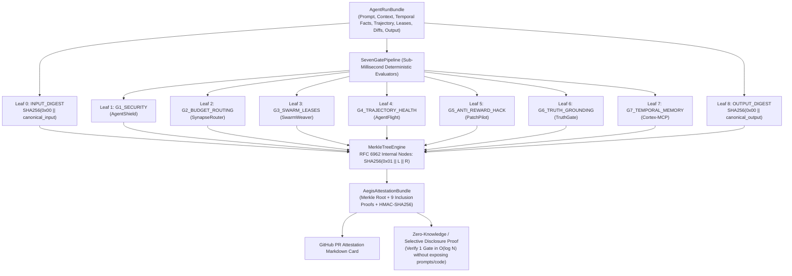

# NexusAegis System Architecture

## 1. Overview: Proof-Carrying Agent Execution (PCAE)

In 1997, George Necula formulated **Proof-Carrying Code (PCC)**, a paradigm in which an untrusted binary must carry an explicit, machine-checkable proof that it satisfies host safety policies before a kernel executes it.

**NexusAegis (`nexus-aegis`)** brings this exact cryptographic contract to **autonomous AI coding and operations agents** through **Proof-Carrying Agent Execution (PCAE)**. When an autonomous agent proposes a pull request, executes shell/MCP tools, modifies unit tests, or synthesizes a technical report, `NexusAegisKernel` evaluates the run across 7 deterministic safety and correctness gates (`G1_SECURITY` through `G7_TEMPORAL_MEMORY`) and binds every gate verdict—along with the canonical input and output digests—into an **RFC 6962 domain-separated binary SHA-256 Merkle tree**.

---

## 2. Unifying the 8-Repository Codesphere Agentic Stack

`nexus-aegis` serves as the cryptographic capstone kernel unifying the algorithms across all 7 specialized engines in the Codesphere Agentic Stack:

| Gate ID | Upstream Repository | Deterministic Verification Algorithm |
| :--- | :--- | :--- |
| **`G1_SECURITY`** | `codesphere-u/agentshield` | Scans `task_prompt`, `retrieved_context`, `tool_trajectory`, and file paths for direct/indirect prompt injection, Unicode zero-width steganography, Base64 smuggling, cloud metadata SSRF (`169.254.169.254`), and `.env`/`.ssh` credential exfiltration. |
| **`G2_BUDGET_ROUTING`** | `codesphere-u/synapse-router` | Verifies `cost_usd <= budget_cap_usd`, enforces token ceilings (`120,000` tokens), and blocks frontier model over-provisioning (`claude-opus-4`, `o1-pro`) on trivial tasks. |
| **`G3_SWARM_LEASES`** | `codesphere-u/swarmweaver` | Audits `file_reads` and `file_writes` against `active_peer_leases` using `fnmatch` glob matching to prevent write-write and dirty-read race conditions across concurrent subagents. |
| **`G4_TRAJECTORY_HEALTH`** | `codesphere-u/agentflight` | Detects `A <-> B` ping-pong oscillation loops, `3x` identical tool stagnation loops, `>= 3` consecutive tool failures, runaway step counts, and malformed MCP tool schemas. |
| **`G5_ANTI_REWARD_HACK`** | `codesphere-u/patchpilot` | Parses `code_patch_before` and `code_patch_after` into Python `ast` trees to block deleted `test_*` functions, weakened assertion counts, `assert True` tautologies, `@pytest.mark.skip` decorator injection, `PYTEST_CURRENT_TEST` env snooping, and bare `except: pass` blocks. |
| **`G6_TRUTH_GROUNDING`** | `codesphere-u/truthgate` | Performs clause-local citation grounding over `final_response` against `retrieved_context` and `workspace_symbols` to catch phantom citations (`[doc_99]`), antonym/negation polarity inversions, numeric metric drift, and hallucinated workspace AST symbols. |
| **`G7_TEMPORAL_MEMORY`** | `codesphere-u/cortex-mcp` | Audits `final_response` and `tool_trajectory` against `temporal_facts` to block stale-fact contamination whenever a fact has `valid_until != None` or `superseded_by != None`. |

---

## 3. RFC 6962 Domain-Separated Merkle Tree & Selective Disclosure

A naive binary Merkle tree that hashes leaves and internal nodes with the same raw SHA-256 function is vulnerable to **second-preimage attacks**: an attacker can present a 64-byte leaf consisting of two concatenated 32-byte internal digests (`L || R`) and claim a depth-$k$ tree has depth $k-1$.

`MerkleTreeEngine` eliminates this class of attacks by enforcing **RFC 6962 (Certificate Transparency) domain separation**:

1. **Leaf Hashing (`0x00` prefix)**:
   $$H_{\text{leaf}}(d) = \text{SHA-256}(\texttt{0x00} \mathbin{\Vert} \text{canonical\_json}(d))$$
2. **Internal Node Hashing (`0x01` prefix)**:
   $$H_{\text{node}}(L, R) = \text{SHA-256}(\texttt{0x01} \mathbin{\Vert} \text{bytes}(L) \mathbin{\Vert} \text{bytes}(R))$$

### Selective Disclosure Verification (`O(log N)`)

Because the 9 leaves (`INPUT_DIGEST`, `G1_SECURITY` .. `G7_TEMPORAL_MEMORY`, `OUTPUT_DIGEST`) are committed into `merkle_root`, an enterprise engineering team can publish only the `merkle_root` and a single gate's `MerkleInclusionProof` (4 sibling hashes = 128 bytes) to prove to an external customer or compliance auditor that `G5_ANTI_REWARD_HACK` or `G1_SECURITY` passed—**without revealing proprietary prompts, internal RAG documents, or source code diffs**.
